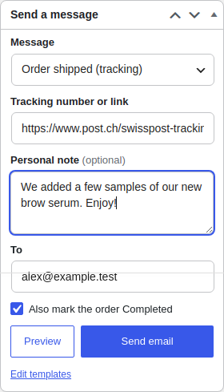
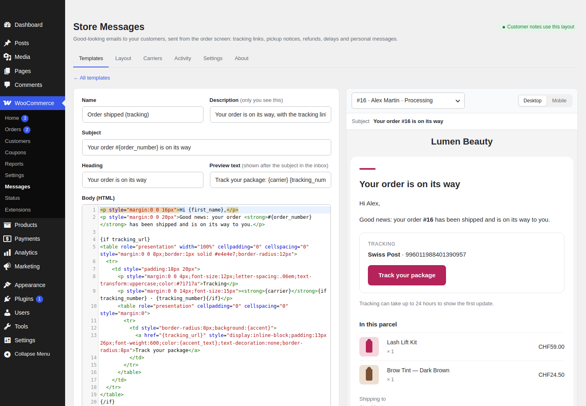
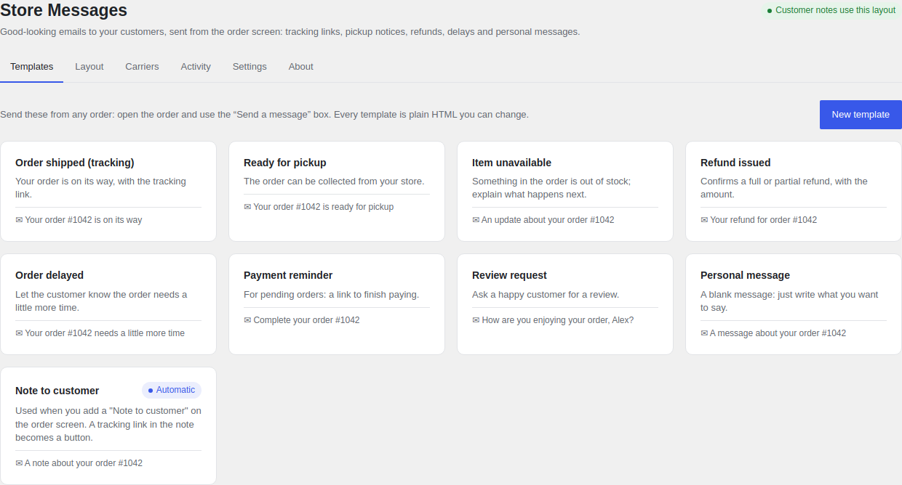
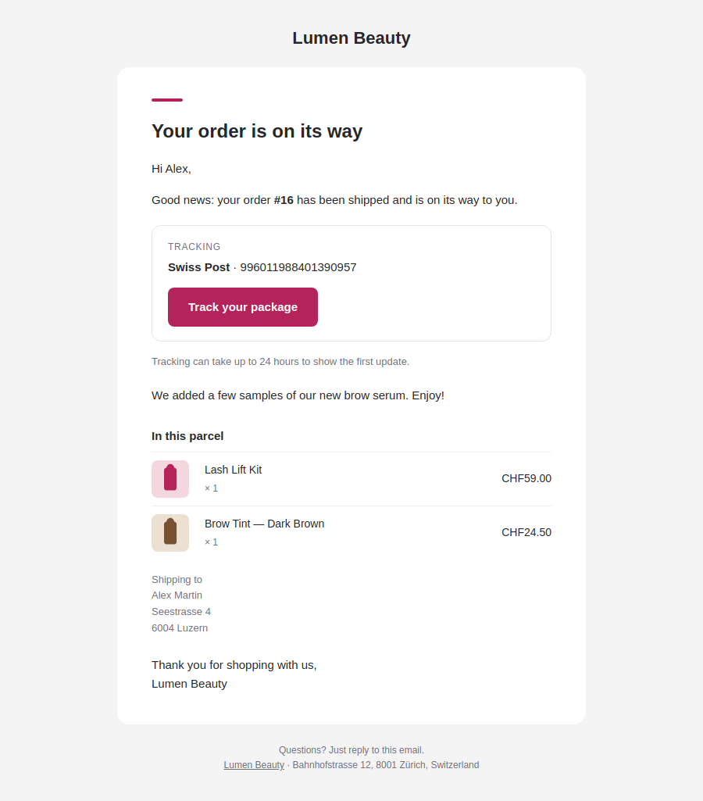

# Store Messages

Beautiful, customisable emails from your WooCommerce store to your customers, sent from the order screen. Templates and layout are plain HTML you control.

WooCommerce's "Note to customer" email is the usual way to send a tracking link, and it looks dated. Store Messages gives every message a clean, modern layout and adds a **Send a message** box to the order screen.

## Features

- **Send from the order**: pick a message, paste the tracking link (or type the number and pick the carrier), add a personal note, preview, send.
- **Built-in occasions**: order shipped (tracking), ready for pickup, item unavailable, refund issued, order delayed, payment reminder, review request and a blank personal message. Add as many of your own as you like.
- **Plain HTML**: every template and the layout around them are HTML in a code editor with a live preview (desktop and mobile), sample or real order data, and test sends.
- **Placeholders**: `{first_name}`, `{order_number}`, `{tracking_url}`, `{order_items}`, `{refund_amount}` and more, plus `{if tracking_url}…{else}…{/if}` blocks.
- **Better customer notes**: "Note to customer" is sent with your layout; a tracking link pasted into a note becomes a "Track your package" button.
- **One email instead of two**: mark the order Completed while sending, without WooCommerce's "Order complete" email on top.
- **Tracking for customers**: shown on the order in My account and in WooCommerce's own emails.
- **A record of everything**: each send becomes a private order note, appears in the order's history and on the Activity tab.
- **Carriers**: Swiss Post, La Poste/Colissimo, DHL, DPD, GLS, UPS, FedEx, PostNL, Poste Italiane, Correos, InPost, Royal Mail, USPS and a universal tracker; edit or add your own.
- **Delivery**: sent through `wp_mail()`, so your SMTP or email-delivery plugin applies. Plain-text alternative included.
- Updates from GitHub through WordPress's normal "Update now".

No accounts, no tracking pixels, no upsells.

## Install

1. Download `store-messages.zip` from the [latest release](https://github.com/tranmani/store-messages/releases/latest).
2. In WordPress: Plugins → Add New → Upload Plugin, choose the zip, activate.
3. WooCommerce → Messages to adjust the layout and templates; open any order to send.

Requires WordPress 6.4+, PHP 8.1+ and WooCommerce. Compatible with WooCommerce's order storage (HPOS).

## Template syntax

| Syntax | Meaning |
|---|---|
| `{first_name}` | A placeholder. Text is HTML-escaped; `{order_items}`, `{message}`, `{note}` and the addresses are HTML. |
| `{if tracking_url}…{/if}` | Shown only when the value is not empty. |
| `{if !message}…{/if}` | Shown only when it is empty. |
| `{if x}…{else}…{/if}` | Either / or. Blocks can be nested. |

The layout is a full HTML document; `{content}` is where a template's body goes, and `{heading}`, `{preheader}`, `{footer}`, `{logo}`, `{accent}`, `{background}`, `{surface}` and `{text}` are available there.

## For developers

- `stms_placeholders` (filter): add or change placeholder values — `( array $values, ?WC_Order $order, array $extra )`.
- `stms_email_html` (filter): the final HTML.
- `stms_email_headers` (filter): mail headers.
- `stms_sent` (action): after a message is sent for an order.
- `stms_update_repository` (filter): point the updater at a fork.

## License

GPL-2.0-or-later.
